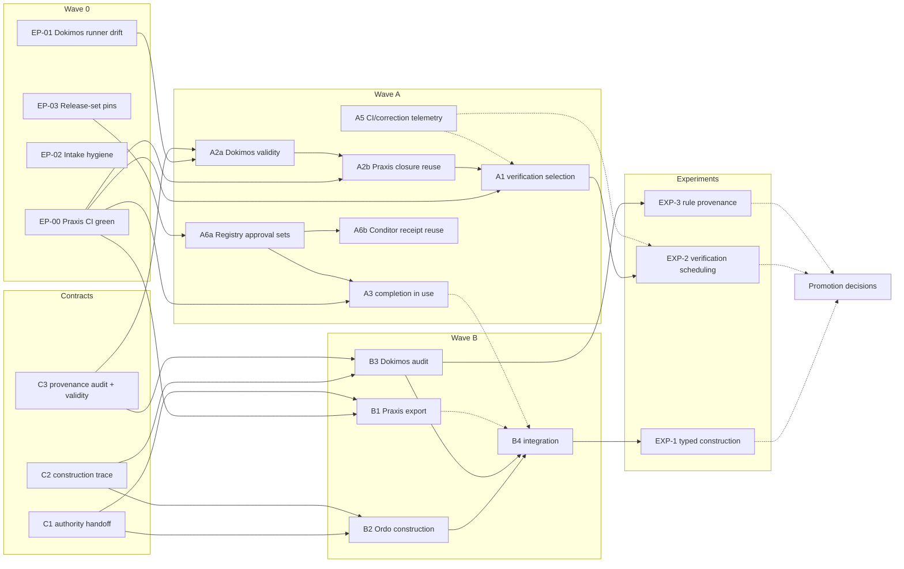

# Dependencies

The increment ids are those in [IMPLEMENTATION-PLAN.md](IMPLEMENTATION-PLAN.md). In the graph:

- `→` means "is a prerequisite of";
- dashed edges are soft prerequisites: they unblock measurement, not implementation.

## Critical path

**EP-00 → A2a → A2b → A1 (shadow) → EXP-2 → promotion of checkpoint and dependency-aware CI**

This is the longest chain, and it carries the largest expected saving: O3, CI per accepted change. Each step is
blocked by the one before it:

- **EP-00:** Praxis cannot run `validate` on main while it is red.
- **A2a → A2b:** reuse needs the validity digests Dokimos defines (C3) before Praxis can reuse across commits.
- **A1:** selection must be measured in shadow before anything is skipped.
- **EXP-2:** the replay needs A1's planner.

The verified-construction chain runs **C1/C2/C3 → B2 ∥ B3 → B4 → EXP-1**. It runs in parallel with the critical path
and shares only C3.

## Parallel lanes (no shared files; separate owners)

| Lane | Increments | Owner repository | Shared interface |
|---|---|---|---|
| L1 | EP-00, A3, A2b, A1, A5, B1, C1, C5 | praxis | C1 (produces), C4/C5 (owns), C3 (consumes) |
| L2 | B2 | ordo | C1 (consumes), C2 (produces) |
| L3 | EP-01, A2a, B3 | dokimos | C2 (consumes), C3 (produces) |
| L4 | EP-03, A6a / A6b | echelon-registry / conditor | C6 |
| L5 | EP-02, EXP-1..3, B4 | cohort-based-engineering plus each repository's intake | all |

**Within L1, Praxis is a single repository with one CI.** Run its increments in this order:

1. EP-00
2. A3
3. A5
4. A2b
5. A1
6. B1

Two concurrent agents on Praxis main would collide on `src/Praxis.Domain/Work/*`.

## Shared interfaces and who may change them

| Interface | Producer | Consumers | Change rule |
|---|---|---|---|
| C1 `echelon.authority-handoff` | praxis | ordo, dokimos | Producer proposes; both consumers' contract tests must pass before a version bump |
| C2 `echelon.construction-trace` | ordo | dokimos, praxis | Same |
| C3 `echelon.provenance-audit` / validity | dokimos | praxis | Same |
| `dokimos.completion-verification/1` | dokimos | praxis | Released; additive only |
| `ros.handoff-authority` v1 | praxis | ordo (not read today) | Frozen; C1 is additive |
| Registry channel / profile | registry | conditor, every repository | Approval-gated (C6) |
| `Invoice.Slice.Probe` API | ordo slice | dokimos invariant oracle | Experimental; changed only together |

## External dependencies and risks

| Dependency | Risk | Mitigation |
|---|---|---|
| GitHub-hosted runner image (ubuntu-26.04, git 2.55) | Silent breakage of tests that match tool output; Playwright platform support | EP-00, EP-01; OD-5 pin policy |
| Praxis release cadence | A3 and A2b need a release before any repository can use them; Rehearsal 3 must not take an unapproved release | A6a approval record; RELEASE-GATES §6 |
| Owner budget authorization | EXP-1, the paid arm of EXP-3, R-EXP-1/2 | No paid run without OD-1 |
| Agent access to git remotes | Pushing program work; observed blocked on 2026-10-23 | EXECUTION-STATE blocker B-1 |
